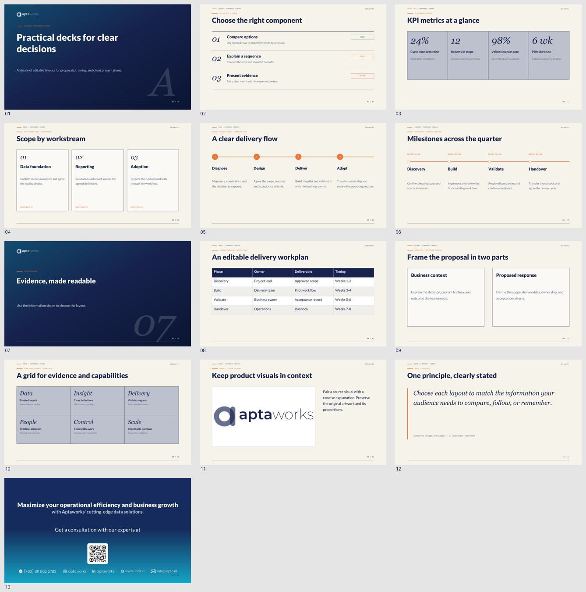

# Aptaworks Document & Presentation Skills

Install two independent skills for branded Aptaworks documents and editable PowerPoint presentations.

## Install

```bash
npx skills add devaptaid/apta-doc-skill
```

Choose the skills and coding agents in the CLI, or install one skill directly:

```bash
# Word, PDF, Markdown, and HTML documents
npx skills add devaptaid/apta-doc-skill --skill apta-doc-proposal

# Editable PowerPoint presentations
npx skills add devaptaid/apta-doc-skill --skill apta-pptx

# List available skills without installing
npx skills add devaptaid/apta-doc-skill --list

# Example: global installation for Codex
npx skills add devaptaid/apta-doc-skill --skill apta-pptx -a codex -g
```

For **Claude Code**, select the agent explicitly:

```bash
npx skills add devaptaid/apta-doc-skill --agent claude-code
# Or install both skills globally for Claude Code
npx skills add devaptaid/apta-doc-skill --skill apta-doc-proposal apta-pptx --agent claude-code -g
```

The CLI installs project skills under `.claude/skills/` (or `~/.claude/skills/` with `-g`). These are standard `SKILL.md` packages, not Codex-only plugins. The same Python scripts, examples, and assets work from Claude Code. See the CLI's [supported agents](https://github.com/vercel-labs/skills/blob/main/docs/agents.md) and the [Claude Code skills documentation](https://code.claude.com/docs/en/skills).

Source: [devaptaid/apta-doc-skill](https://github.com/devaptaid/apta-doc-skill/). Installation uses the [skills CLI](https://github.com/vercel-labs/skills), documented on [skills.sh](https://skills.sh/docs). Use a supported Node.js version as specified by the CLI. Skill installation copies instructions, scripts, references, and assets; conversion dependencies are installed separately.

Each skill works independently. For manual installation, copy each complete skill folder into `.claude/skills/` for Claude Code or the appropriate directory for your agent. Keep all assets, examples, and references. When publishing, push the complete `skills/` tree to the GitHub repository's default branch: the CLI reads GitHub contents, not an unpublished local checkout.

## Choose a skill

| Skill | Purpose | Outputs |
|---|---|---|
| [apta-doc-proposal](skills/apta-doc-proposal/SKILL.md) | A4 proposals and business documents | Markdown, HTML, PDF, editable Word `.docx` |
| [apta-pptx](skills/apta-pptx/SKILL.md) | Proposals, training, credentials, client updates | Markdown, self-contained HTML, editable `.pptx`; slide PDF through a renderer |

When the format is unspecified, the agent asks whether you want Markdown, PDF, Word, or PowerPoint. It accepts multiple formats and does not repeat the question when you have already chosen. Markdown-only requests stop before compilation. Word and slide decks use separate Markdown sources because their content structures differ.

At the initial brief, choose **direct final-file delivery** or **Markdown + HTML for review first**. Both use the full pipeline:

- Documents: **Markdown → HTML → DOCX/PDF**.
- Presentations: **Markdown → HTML → PPTX**.

Direct delivery runs every stage without a review pause and retains the source files. Review-first stops at Markdown/HTML until you ask to export. The exporters consume the actual reviewed HTML; they do not regenerate it from Markdown and discard your edits.

## Use the skills

```text
Use the apta-doc-proposal skill to create an English proposal in Word and PDF.
Deliver the final files directly and keep Markdown/HTML as sources.
Brief: [audience, objectives, scope, deliverables, schedule, and pricing].

Use the apta-pptx skill to create an English presentation.
Prepare Markdown and HTML for review before exporting PowerPoint.
Use clean Aptaworks editorial styling and the reference consultation closing.
Include a KPI summary, workstream cards, delivery flow, timeline, and workplan.

Use the apta-pptx skill to draft a Markdown outline only.
```

In Claude Code, you can also invoke `/apta-doc-proposal` or `/apta-pptx` directly. In Codex, use `$apta-doc-proposal` or `$apta-pptx`.

Word means `.docx`; legacy `.doc` and `.ppt` files are not supported. Explicit requests for Word or PDF already authorize those exports. The document scripts retain an `--approved` flag to record the user's format choice without requiring a second confirmation.

## Preview the examples

All generated examples are in English. Example metrics and plans are illustrative.

| Example | Source | Editable output | Preview |
|---|---|---|---|
| A4 proposal | [Markdown](skills/apta-doc-proposal/examples/example.md) | [Word](skills/apta-doc-proposal/examples/example.docx) | [PDF](skills/apta-doc-proposal/examples/example.pdf), [HTML](skills/apta-doc-proposal/examples/example.html) |
| Presentation component library | [Markdown](skills/apta-pptx/examples/example.md), [HTML](skills/apta-pptx/examples/example.html) | [PowerPoint](skills/apta-pptx/examples/example.pptx) | [PDF](skills/apta-pptx/examples/example.pdf) |

The 13-slide library demonstrates a branded cover, detailed ledger, KPI metrics, workstream cards, connected flow, timeline, section divider, native table, two-column proposal, proof grid, source image, quote, and the reference consultation closing. Text, tables, cards, KPI cells, flow nodes, and timeline elements remain editable. The official logos, QR code, contact artwork, and source images remain images.

HTML previews include the original bottom dot slider, with keyboard, wheel, and swipe controls. Content titles use 36pt, cover titles use 48pt, and compact headers leave more room for content. Headers display `Aptaworks`; cover/header/footer labels omit “Editorial”. Navigation is hidden in PowerPoint and print output.




The presentation follows the supplied [design reference](skills/apta-pptx/references/upstream.html) for navy gradients, orange connectors, strong Lato headings, editorial numerals, and the centered navy-to-cyan closing with the complete contact row. Generated presentation backgrounds have **no paper grid**. Table borders and meaningful diagram lines remain. See the [slide design system](skills/apta-pptx/references/design-system.md), [Markdown source format](skills/apta-pptx/references/source-format.md), and [HTML conversion contract](skills/apta-pptx/references/html-conversion.md).

## Runtime setup

Both generators require Python 3.10+. PPTX generation needs no additional Python packages. Install Lato for matching typography. The native deck uses Georgia for editorial numerals and Consolas for compact metadata; the HTML reference uses Newsreader and DM Mono. Fonts are not bundled or embedded, so check rendering on the recipient's computer.

After a project-level Claude Code install, set up the document dependencies from the installed skill:

```bash
python -m venv .venv
# Activate the virtual environment for your OS and shell first.
python -m pip install -r .claude/skills/apta-doc-proposal/requirements.txt
python -m playwright install chromium
```

For a global Claude install, use `~/.claude/skills/apta-doc-proposal/requirements.txt`. For development from a repository checkout, use `skills/apta-doc-proposal/requirements.txt`. Other agents use their own installation paths. The requirements file is bundled with the document skill.

No conversion script installs packages automatically. DOCX-only generation does not launch Chromium. PDF slides require PowerPoint or LibreOffice; the PPTX generator itself does not require either application.

## Build from a checkout

Run these commands from the repository root. An agent using an installed skill should resolve scripts from that skill's installation directory and use absolute source/output paths.

```bash
# Presentation: direct delivery, retaining HTML
python skills/apta-pptx/scripts/build_deck.py skills/apta-pptx/examples/example.md --output output/deck.pptx
python skills/apta-pptx/scripts/validate_deck.py output/deck.pptx --source skills/apta-pptx/examples/example.md

# Presentation: prepare HTML for review, then export that file
python skills/apta-pptx/scripts/build_deck.py skills/apta-pptx/examples/example.md --output output/review.html
python skills/apta-pptx/scripts/build_deck.py output/review.html --output output/review.pptx

# Document
python skills/apta-doc-proposal/scripts/build_proposal.py skills/apta-doc-proposal/examples/example.md --output-dir output/document --pdf --docx --approved
python skills/apta-doc-proposal/scripts/validate_outputs.py output/document/example.html output/document/example.pdf output/document/example.docx

# Document: Markdown + HTML first; export reviewed HTML after approval
python skills/apta-doc-proposal/scripts/build_proposal.py skills/apta-doc-proposal/examples/example.md --output-dir output/review-document
python skills/apta-doc-proposal/scripts/build_proposal.py output/review-document/example.html --output-dir output/final-document --docx --approved
```

For document HTML only, omit `--pdf --docx --approved`; for presentation HTML only, use an `.html` output path. For Markdown only, write the source without running a generator. Document HTML uses an adjacent `assets/` folder. Presentation HTML embeds its PNGs and can be shared as one file. Set `language: en` or `language: id` in document frontmatter to localize the contents heading and document furniture.

## Validate changes

```bash
python -m unittest discover -s tests -v
# Optional interaction checks and screenshots; needs Playwright + Chromium
python tests/check_deck_browser.py --output .build/deck-browser-check
npx skills add . --list
# Real CLI installation and generator smoke test in an isolated Claude project
python tests/check_install.py --workspace .build/claude-check
# After publishing, test the GitHub shorthand itself
python tests/check_install.py --source devaptaid/apta-doc-skill --workspace .build/claude-github-check
```

Structural checks verify package relationships, assets, slide bounds, source coverage, and editable document fields. Render the actual PPTX in PowerPoint or LibreOffice and inspect every slide for visual fit. See [the audit report](docs/AUDIT.md) for the checks performed and their limits.

Word's contents page uses editable TOC/PAGEREF fields. Refresh with **Ctrl+A, F9** to populate Word's own page numbers; PDF pagination is not copied into Word. Refresh again after editing the document.

The slide compiler supports a documented Markdown/positioned-HTML subset, native tables, cards, metrics, editable diagrams, notes, and embedded PNG images. Visible HTML text, inline position/typography, tables, and notes feed the native PPTX exporter. Rich Markdown, native charts, animations, arbitrary web-page conversion, and SVG input are not implemented.

## Repository layout

```text
skills/
  apta-doc-proposal/   # Document instructions, scripts, assets, references, examples
  apta-pptx/           # Presentation instructions, scripts, assets, references, examples
tests/                # Regression tests and optional native Office rendering helper
docs/AUDIT.md         # Findings, verification, and limitations
```

Aptaworks logos and brand assets remain the property of their owner. No general redistribution license has been assigned in this repository.
